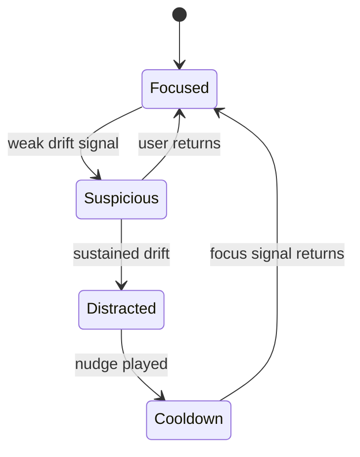

# Supervisor V1 Plan

**Historical plan (2026-08-12).** Do not implement from this file. Current work: `plans/STATUS.md`. Baseline branch: `feat/window-supervision`.

Last updated: 2026-08-12

## Product Summary

Supervisor is a local desktop focus companion.

During a focus session, the app watches the active desktop window, decides whether the user is drifting, and plays cached voice nudges from the selected local voice profile. V1 should feel like a tiny, opinionated focus buddy, not a surveillance dashboard and not an AI productivity suite.

The intended personality wedge:

> "Mom mode for your laptop: a familiar voice that catches you drifting, tells you to breathe, and nudges you back before the spiral wins."

The privacy promise:

> No cloud processing. No telemetry. No browsing history upload. No audio upload. No camera in V1. Local metadata only.

## V1 Requirements

1. Desktop app for macOS and Windows.
2. CPU-first voice generation. A normal laptop should be able to use it.
3. User can start a focus session with:
   - Goal
   - Duration
   - Strictness
   - Optional allowed/distracting app rules
4. App samples the active desktop window while a session is running.
5. App classifies the current state as focused, neutral, suspicious, or distracted.
6. App plays cached voice reminders when distraction persists.
7. User can pause, snooze, mark current app/title as relevant, or mark it distracting.
8. User can create, save, switch, and delete multiple local voice profiles.
9. User can view a simple focus history.
10. All data is stored locally.

## V1 Non-Goals

1. No Chrome extension.
2. No exact browser tab/URL integration.
3. No webcam or phone detection.
4. No local LLM in the hot path.
5. No hard app blocking unless it falls out cheaply from OS primitives.
6. No complex dashboard.
7. No account system.
8. No cloud voice cloning.

## Guiding Principle

Use the lazy senior dev path:

1. Use the smallest reliable primitive.
2. Prefer OS/window metadata before page contents, screenshots, OCR, or LLMs.
3. Prefer cached audio playback before live generation.
4. Add AI only when rules fail in a specific, measured way.
5. Keep one strong loop: detect drift, nudge, learn from feedback.

## What Desktop-Level "Surveillance" Means

Use a softer internal term: `activity sensing`.

V1 should collect enough signal to be useful without being creepy:

| Signal | V1? | Notes |
| --- | --- | --- |
| Active app name | Yes | Core signal. |
| Active process id/path | Yes | Needed for stable app rules. |
| Active window title | Yes, when permission allows | Most useful text signal. |
| Window bounds/position | Yes, if available | Useful later for multi-monitor context. |
| Idle time | Yes | Avoid nudging when the user stepped away. |
| App switch events | Derived | Polling every second is enough. |
| Browser URL/domain | No | V2 via extension if needed. |
| Open tab list | No | V2 via extension if needed. |
| Page contents | No | Avoid in V1. |
| Keystrokes | No | Do not keylog. |
| Screenshots/OCR | No | Too creepy and unnecessary for V1. |
| Camera frames | No | V2 only. |

### Platform Notes

| Platform | Recommended primitive | What we get | Caveat |
| --- | --- | --- | --- |
| Windows | Win32 active window APIs | Foreground window, title, pid, process path, idle time | Reliable enough for V1. |
| macOS | Frontmost app plus window-list metadata | App name, pid, title/bounds when permission is granted | Window title may require Screen Recording permission. |

Windows has official APIs for foreground-window and title capture: `GetForegroundWindow` retrieves the window the user is working with, and `GetWindowTextW` reads a window's title text when available ([Microsoft GetForegroundWindow](https://learn.microsoft.com/en-us/windows/win32/api/winuser/nf-winuser-getforegroundwindow), [Microsoft GetWindowTextW](https://learn.microsoft.com/en-us/windows/win32/api/winuser/nf-winuser-getwindowtextw)). Windows idle detection can use `GetLastInputInfo`, which Microsoft documents as useful for input-idle detection ([Microsoft GetLastInputInfo](https://learn.microsoft.com/en-us/windows/win32/api/winuser/nf-winuser-getlastinputinfo)).

For a lazy first implementation, test `active-win-pos-rs`. It exposes active window id, process id, position, title, process path, and app name across Windows, macOS, and Linux; its README notes that macOS window titles are empty unless Screen Recording permission is enabled ([active-win-pos-rs](https://github.com/dimusic/active-win-pos-rs)).

### V1 Capture Strategy

Poll every 1 second while a session is running.

Do not build system-wide event hooks first. Polling is good enough, easier to debug, easier to test, and much less likely to create OS-specific weirdness.

Each sample should normalize to:

```json
{
  "captured_at": "2026-08-12T10:00:00Z",
  "platform": "macos",
  "app_name": "Google Chrome",
  "process_path": "/Applications/Google Chrome.app",
  "process_id": 12345,
  "window_title": "Supervisor V1 plan - Google Docs",
  "window_id": "opaque-id",
  "bounds": { "x": 0, "y": 0, "width": 1440, "height": 900 },
  "idle_seconds": 3
}
```

Store raw samples only during the session by default. Persist compressed segments for history:

```json
{
  "app_name": "Google Chrome",
  "title_hint": "YouTube",
  "started_at": "...",
  "ended_at": "...",
  "classification": "distracted"
}
```

## Focus Engine

Do not use an LLM for V1 classification.

Use a deterministic state machine:



### Classification Inputs

1. User goal text.
2. Allowed apps.
3. Distracting apps.
4. Neutral apps.
5. Window title tokens.
6. Idle time.
7. Time spent away from productive apps.
8. Recent user feedback.

### Simple Scoring

| Condition | Score effect |
| --- | ---: |
| App explicitly distracting | +100 |
| Window title matches distracting keyword | +60 |
| App explicitly allowed | -100 |
| Window title matches goal keyword | -40 |
| User idle for more than 90 seconds | no nudge |
| Same distracting state for 30 to 60 seconds | trigger nudge |
| User recently snoozed | suppress nudge |

Default thresholds:

| Setting | Gentle | Normal | Strict |
| --- | ---: | ---: | ---: |
| Drift duration before nudge | 90s | 60s | 30s |
| Nudge cooldown | 8m | 5m | 2m |
| Max nudges per 30m | 2 | 4 | 8 |

### Feedback Controls

Keep controls tiny:

1. `Snooze`
2. `Relevant`
3. `Distracting`
4. `Pause`

These are enough. Do not add fifteen knobs.

## Voice Model Decision

### Default V1 Candidate: Chatterbox-Nano

Use Chatterbox-Nano as candidate A for V1.

Reasons:

1. It is 110M parameters.
2. It targets on-device and CPU inference.
3. The model card claims 3x faster-than-realtime generation on an 8-core CPU.
4. It supports voice cloning from a reference clip.
5. It supports paralinguistic tags like `[laugh]` and `[chuckle]`, which may help personality.
6. It is MIT licensed.
7. It gives us direct text-to-speech: phrase in, reference voice in, WAV out.

Source: [ResembleAI Chatterbox-Nano model card](https://huggingface.co/ResembleAI/chatterbox-nano) and [Chatterbox GitHub repo](https://github.com/resemble-ai/chatterbox).

Risks:

1. Nano is English-only.
2. It is newer than OpenVoice, so packaging/runtime surprises are possible.
3. PyTorch CPU packaging may still make the app large.
4. The "mom admonishment" style must be tested. Model claims are not enough.

### Backup Candidate: OpenVoice V2

Use OpenVoice V2 as candidate B, especially for multilingual or style-control exploration.

Reasons:

1. MIT licensed and commercial-friendly.
2. Strong voice-color cloning story.
3. Supports multiple languages and cross-lingual cloning.
4. Offers flexible style control around emotion, accent, rhythm, pauses, and intonation.

Source: [OpenVoice GitHub repo](https://github.com/myshell-ai/OpenVoice).

Risks:

1. Less direct for our main use case.
2. V2 usage requires MeloTTS in the documented pipeline.
3. Official usage docs are more developer/research oriented, with Windows setup listed as community contributed.
4. It may be better as a V2 multilingual experiment than the V1 default.

OpenVoice's own usage doc says V2 requires downloading checkpoints, installing MeloTTS, and following notebook demos; it also labels Windows installation as community-contributed ([OpenVoice usage docs](https://github.com/myshell-ai/OpenVoice/blob/main/docs/USAGE.md)).

### Built-In Starter Voices

The app must work even before the user clones a voice.

Do this with bundled starter voice profiles, not with a model loaded at runtime.

Each starter profile should be a directory of pre-rendered clips plus metadata:

```text
voice_profiles/
  starter-mom/
    profile.json
    clips/
      focus_beta.opus
      enough_scrolling.opus
      breathe_and_return.opus
  starter-coach/
    profile.json
    clips/
      one_next_action.opus
      return_to_task.opus
```

This means first launch needs no TTS inference. The user can start a focus session, pick a starter voice, and hear personality-filled nudges immediately.

Important distinction:

1. Chatterbox's general 500M English path can generate without a reference clip.
2. Chatterbox-Nano and Turbo are the CPU/low-latency candidates we care about, and their documented examples require a reference clip for voice cloning.
3. Therefore, V1 should not rely on Chatterbox-Nano having a polished built-in voice library.

Candidate for generating starter voice clips at build time: Kokoro 82M.

Reasons:

1. 82M parameters.
2. Apache 2.0 license.
3. Lightweight TTS with strong adoption.
4. Useful for creating a starter pack without forcing voice cloning in onboarding.

Source: [Kokoro-82M model card](https://huggingface.co/hexgrad/Kokoro-82M).

This is not the main magic. It is a reliability layer.

## Voice Product Direction

The model does not create the whole personality. The product does.

V1 should create personality through:

1. The cloned voice.
2. Phrase packs.
3. Strictness level.
4. A few language-flavor words.
5. Timing.
6. User editing/removal of phrases they hate.

### Saved Voice Architecture

A saved voice is not a loaded model.

A saved voice is:

1. Metadata: name, persona, language, strictness defaults, consent state.
2. Optional reference audio: kept only if the user chooses to keep it.
3. Phrase text: editable local lines.
4. Generated clips: one local audio file per phrase.
5. Generation settings: model, seed, exaggeration, cfg weight, created version.

Switching voices should only change `selected_voice_profile_id`.

During a normal focus session, the app should never load PyTorch, Chatterbox, OpenVoice, or any voice model. It should only play an existing clip from disk.

Target normal runtime:

| Mode | Target RAM | Hard ceiling |
| --- | ---: | ---: |
| Focus session with cached clips | Under 300 MB preferred | Under 1 GB |
| Voice generation job | Under 2 GB preferred | Under 4 GB only if temporary |

Implementation rule:

Run voice generation in a separate worker process. When the phrase bank is complete, terminate the worker and confirm memory returns to the normal app budget. Do not import PyTorch into the main Tauri process.

### Consent Rule

Voice setup copy should be explicit:

> Clone only your own voice or a voice you have permission to use.

This matters because the "mom voice" idea is emotionally powerful and legally sensitive.

### Phrase Pack Examples

Tone: gentle

1. "Deep breath. Back to the thing."
2. "You drifted a little. Come back."
3. "One next action. That is all."

Tone: mom

1. "Beta, focus. You opened this for what?"
2. "Enough scrolling. Finish the thing first."
3. "You can wander later. Work now."
4. "Arre, come back. One tab, one task."

Tone: stern

1. "This is not the task."
2. "Close it and return."
3. "You said this mattered. Act like it."

Tone: kind-reset

1. "Pause. Inhale. Now back to the file."
2. "No drama. Just return."
3. "You are not failing. You are drifting. Come back."

Store phrases as editable local text. Generate audio from them.

### Low-Latency Strategy

Do not synthesize at the moment of distraction.

Pipeline:

1. User selects a starter voice or records/imports a permitted reference clip.
2. App validates audio quality locally if a reference clip is used.
3. App generates 20 to 60 reminder clips locally for that voice profile.
4. App stores generated WAV/Opus clips locally.
5. During focus mode, app plays cached audio instantly.
6. If the user adds new phrases, generate only the missing clips.
7. Live TTS is never part of the nudge path in V1.

This gives "instant" alerts even if generation is slow on a low-end CPU.

## Required Voice Bakeoff

Before building the full app, run a small CPU bakeoff.

Input:

1. One 20 to 30 second reference clip.
2. 20 fixed phrases across gentle, mom, stern, and kind-reset.
3. One Mac laptop.
4. One ordinary Windows laptop.

Measure:

| Metric | Target |
| --- | --- |
| Model install time | Under 30 min for dev environment |
| Cold model load | Under 30 sec preferred |
| Generate 20 short clips | Under 3 min preferred, under 8 min acceptable |
| Voice worker peak RAM | Under 2 GB preferred, under 4 GB maximum |
| Normal app RAM after worker exits | Under 300 MB preferred, under 1 GB maximum |
| Voice similarity | Subjective 4/5 or better |
| Admonishment quality | Subjective 4/5 or better |
| Bad hallucinations | Zero in phrase bank |
| Packaging feasibility | Clear path to app bundle |

Decision:

1. If Chatterbox-Nano passes, ship it in V1.
2. If Chatterbox-Nano quality fails but latency is good, test Turbo as optional "better quality" mode.
3. If Chatterbox packaging fails, try OpenVoice V2.
4. If both fail on weak machines, ship V1 with fallback voice and keep cloning behind an experimental toggle.

## Recommended Tech Stack

| Layer | Choice | Why |
| --- | --- | --- |
| App shell | Tauri 2 | Small, native, good desktop utility fit. |
| Frontend | React + TypeScript + Vite | Fast to build, enough structure. |
| UI primitives | Radix/shadcn-style components + Tailwind | Fast, accessible, easy to customize. |
| Native watcher | Rust via Tauri command | Close to OS APIs, easy to call from UI. |
| Active window library | Start with `active-win-pos-rs` spike | Gets us most metadata quickly. |
| Voice worker | Python sidecar, short-lived | TTS ecosystem is Python-first; keep model RAM out of the main app. |
| Voice model | Chatterbox-Nano candidate for generation jobs | Best CPU-first direct-cloning candidate, but not kept loaded during focus mode. |
| Storage | SQLite + local audio files | Boring and reliable. |
| Audio playback | Native/local file playback | Cached clips should play instantly. |

Tauri is still the right product shell unless the voice sidecar packaging becomes painful. Tauri apps use Rust plus HTML rendered in a WebView, can support tray interfaces, and use the OS webview rather than shipping a full browser runtime ([Tauri architecture](https://v2.tauri.app/concept/architecture/)). Tauri also supports bundling external binaries called sidecars, including Python CLI apps packaged with PyInstaller ([Tauri sidecar docs](https://v2.tauri.app/develop/sidecar/)). Its tray docs cover the exact utility-app shape we want ([Tauri system tray docs](https://v2.tauri.app/learn/system-tray/)).

Alternative:

Use Python + PySide6 only for throwaway model testing. Do not use it as the product shell unless Tauri sidecars fail badly.

## UI Plan

Keep the app to three screens.

### 1. Start Focus Session

Primary screen.

Controls:

1. Goal input
2. Duration
3. Strictness: gentle, normal, strict
4. Voice/persona selector
5. Start button

During session:

1. Current status: focused, suspicious, distracted, idle
2. Current app/title hint
3. Snooze
4. Mark relevant
5. Pause/stop

### 2. Settings

Controls:

1. Voice profile
2. Record/import voice sample
3. Regenerate phrase bank
4. Personality/tone pack
5. Strictness defaults
6. App rules: allowed, neutral, distracting
7. Delete local voice/data

### 3. History

Show:

1. Session list
2. Focus minutes
3. Distracted minutes
4. Nudges played
5. Top distractions

No big dashboard. No productivity horoscope.

### Visual Direction

Minimal, punchy, a little personal.

1. One primary action per screen.
2. High contrast.
3. Tight spacing.
4. Few controls.
5. Personality comes from voice and copy, not clutter.
6. Avoid generic SaaS gradients and fake AI dashboard cards.

## Local Data Model

SQLite tables:

1. `sessions`
2. `activity_segments`
3. `app_rules`
4. `voice_profiles`
5. `voice_phrases`
6. `voice_clips`
7. `nudge_events`
8. `settings`

Files:

1. Voice reference clips, if user chooses to keep them.
2. Generated audio clips, grouped by voice profile.
3. Bundled starter voice clips.
4. Local model files, used only by the generation worker.

Privacy defaults:

1. No telemetry.
2. No crash upload.
3. No remote fonts.
4. No analytics SDK.
5. No network permission needed after model installation.
6. Offer "delete voice sample after generating phrase bank."
7. Offer "delete all local history."

## V1 Build Phases

### Phase 0: Voice Bakeoff

Goal: decide whether Chatterbox-Nano is good enough.

Deliverables:

1. Script: `generate_phrase_bank.py`
2. Inputs: reference clip + phrase JSON
3. Outputs: generated audio folder + timing/RAM report
4. Compare Chatterbox-Nano vs OpenVoice V2 only if Nano fails or feels weak.
5. Verify the worker process exits and normal app memory returns under the budget.

Gate:

Do not build the full voice UI until this passes.

### Phase 1: Desktop Activity Spike

Goal: prove active window capture on macOS and Windows.

Deliverables:

1. Tiny Rust/Tauri command returning normalized active-window sample.
2. Permission-state handling on macOS.
3. Polling loop at 1 Hz.
4. Local debug screen showing current sample.

Gate:

If macOS title capture requires Screen Recording, the app must explain that clearly and degrade to app-name-only until permission is granted.

### Phase 2: Focus Engine

Goal: turn samples into useful state.

Deliverables:

1. Rule model.
2. State machine.
3. Cooldown/hysteresis.
4. Unit tests for scoring and nudge timing.

Gate:

No false nudge immediately after app switch. No nudge while idle.

### Phase 3: Minimal UI

Goal: usable V1 app shape.

Deliverables:

1. Start screen.
2. Settings screen.
3. History screen.
4. Tray menu.
5. Pause/snooze/relevant/distracting controls.

Gate:

A new user can start a session in under 30 seconds.

### Phase 4: Voice Integration

Goal: voice alerts that feel instant.

Deliverables:

1. Voice profile setup.
2. Local phrase bank generation.
3. Cached audio playback.
4. Regenerate phrase bank.
5. Delete voice/profile.

Gate:

Nudge playback starts in under 250 ms because it uses cached audio.

### Phase 5: Packaging and Privacy QA

Goal: installable offline-first build.

Deliverables:

1. macOS build.
2. Windows build.
3. No unexpected network calls.
4. Local data deletion tested.
5. Permissions copy reviewed.
6. Basic smoke test checklist.

Gate:

App can run a focus session offline after installation.

## V1 Acceptance Criteria

1. User can install app on macOS and Windows.
2. User can create or select a local voice profile.
3. User can start a focus session with a goal and strictness.
4. App samples active app/window locally.
5. App detects sustained distraction using rules.
6. App plays a cached personality-filled voice nudge.
7. User can snooze or mark current context relevant.
8. App records simple local session history.
9. App works without internet after setup.
10. No Chrome extension or webcam required.

## Main Risks

| Risk | Mitigation |
| --- | --- |
| Voice clone quality is not good enough on CPU | Bakeoff first; Chatterbox-Nano candidate, OpenVoice V2 backup, Kokoro fallback. |
| Voice generation is slow | Generate phrase bank ahead of time. Never synthesize in the hot path. |
| Normal app RAM is too high | Keep voice models in a separate short-lived process; focus mode only plays cached audio. |
| PyTorch/model packaging is huge | Measure early. Package sidecar per platform. Consider optional model download later. |
| macOS permissions feel scary | Explain Screen Recording only reads window metadata; degrade gracefully. |
| Focus classification is annoying | Use hysteresis, cooldowns, and user feedback buttons. |
| "Mom voice" feels legally/ethically risky | Consent wording, local-only storage, easy deletion, built-in voices. |
| UI gets bloated | Three screens only. One primary action per screen. |

## Recommended First Week

1. Build the voice bakeoff script.
2. Test Chatterbox-Nano with a real reference voice and 20 mom-mode phrases.
3. In parallel, spike active-window capture on your own OS.
4. If voice passes, scaffold Tauri.
5. Build the focus state machine before polishing UI.
6. Add the three screens.
7. Wire cached audio nudges.

The first true milestone is not "app scaffold exists."

The first true milestone is:

> Start a focus session, open a distraction, wait 60 seconds, and hear the cloned voice say something that makes you laugh slightly and return to work.
